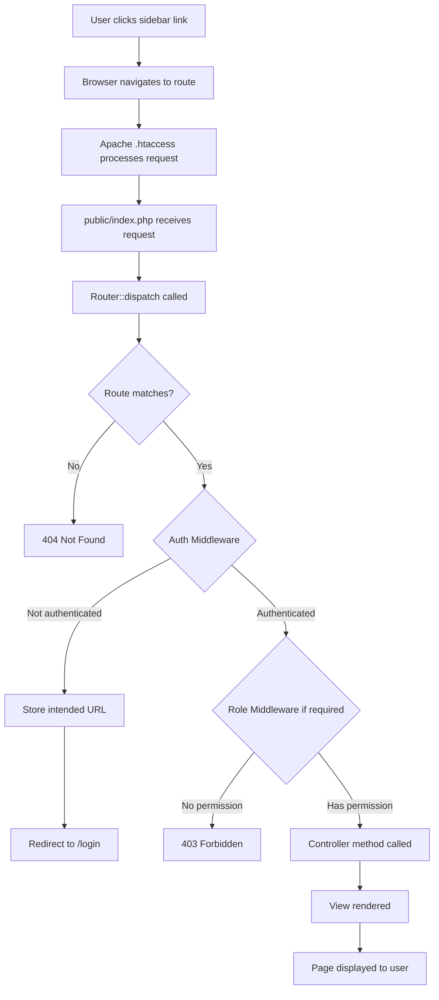
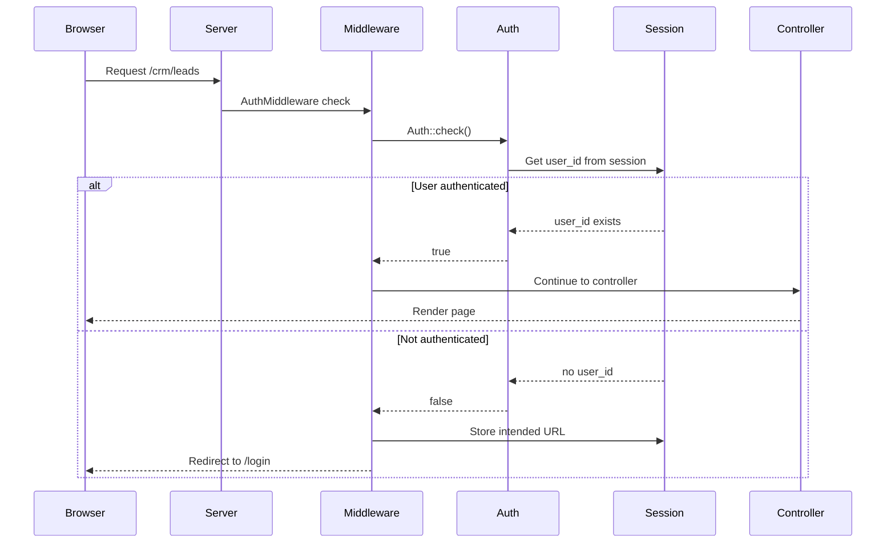
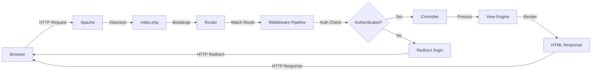
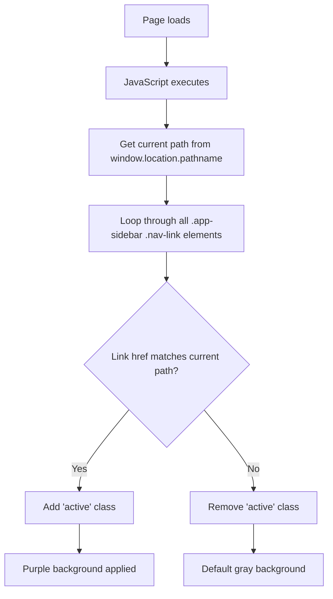
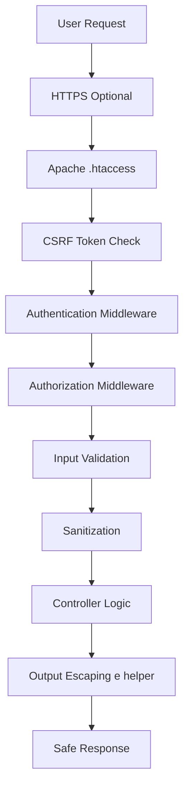
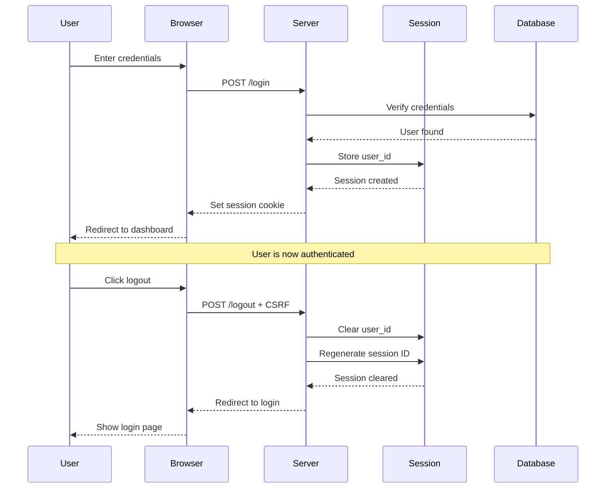
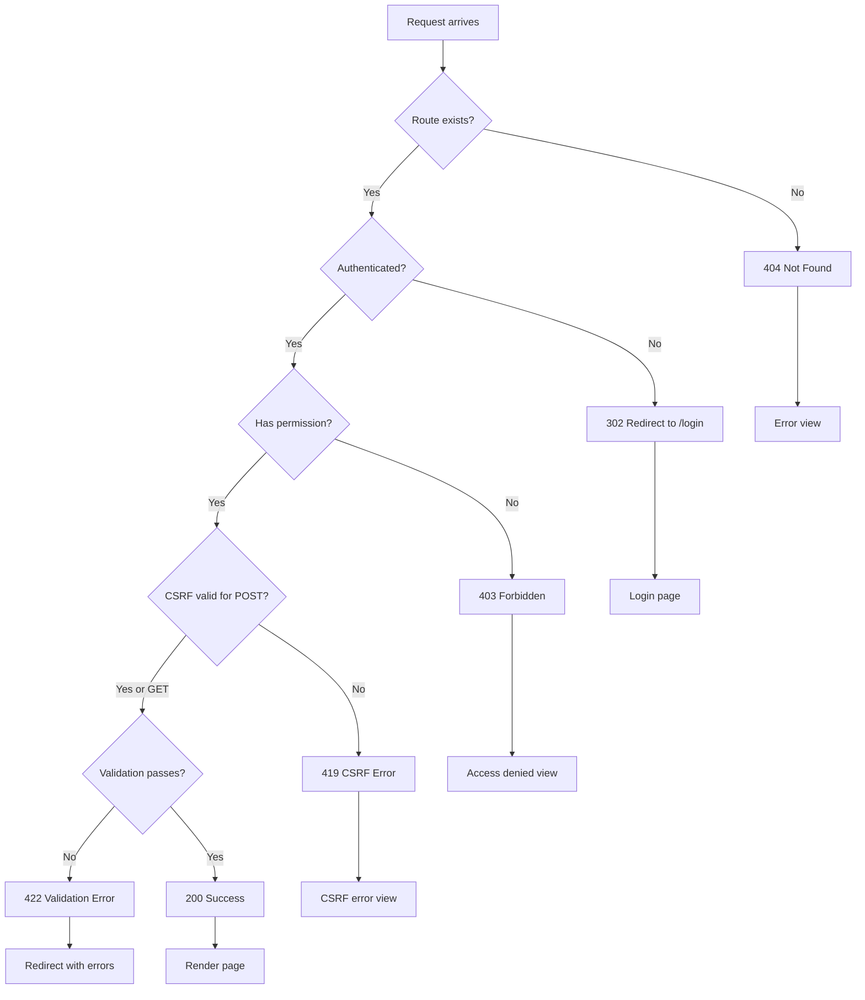

# Dashboard Navigation - Technical Flow Diagram

## Complete Navigation Flow

### 1. Logout Flow (Fixed)

```mermaid
graph TD
    A[User clicks Logout link] --> B[JavaScript intercepts click event]
    B --> C[Prevent default anchor behavior]
    C --> D[Find hidden logout form]
    D --> E[Submit POST form with CSRF token]
    E --> F[Server receives POST /logout]
    F --> G{CSRF Token Valid?}
    G -->|Yes| H[AuthController@logout]
    G -->|No| I[403 CSRF Error]
    H --> J[Auth::logout called]
    J --> K[Clear session user_id]
    K --> L[Regenerate session ID]
    L --> M[Flash success message]
    M --> N[Redirect to /login]
    N --> O[User sees login page with message]
```

### 2. Navigation Link Flow



### 3. Authentication Flow



### 4. Complete Request-Response Cycle



## Route Configuration Map

### Dashboard & Auth Routes
```
GET  /                    → welcome view (public)
GET  /login               → AuthController@showLogin (guest only)
POST /login               → AuthController@login (guest only)
POST /logout              → AuthController@logout (auth required) ✅ FIXED
GET  /dashboard           → DashboardController@index (auth required)
```

### CRM Module Routes
```
GET  /crm/leads           → LeadController@index (auth)
GET  /crm/contacts        → ContactController@index (auth)
GET  /crm/accounts        → AccountController@index (auth)
GET  /crm/opportunities   → OpportunityController@index (auth)
GET  /crm/activities      → ActivityController@index (auth)
```

### ERP Module Routes
```
GET  /erp/inventory       → InventoryController@index (auth)
GET  /erp/sales           → SalesOrderController@index (auth)
GET  /erp/purchases       → PurchaseOrderController@index (auth)
GET  /erp/finance         → FinanceController@index (auth)
```

### CMS Module Routes
```
GET  /cms/pages           → PageController@index (auth)
GET  /cms/posts           → PostController@index (auth)
GET  /cms/media           → MediaController@index (auth)
```

### PIM Module Routes
```
GET  /pim/products        → ProductController@index (auth)
GET  /pim/categories      → CategoryController@index (auth)
```

### Admin Module Routes
```
GET  /admin/users         → UserController@index (auth + role:admin)
GET  /admin/roles         → RoleController@index (auth + role:admin)
GET  /admin/settings      → SettingsController@index (auth + role:admin)
```

## Middleware Pipeline

### Standard Route (e.g., /crm/leads)
```
Request → AuthMiddleware → Controller → Response
```

### Admin Route (e.g., /admin/users)
```
Request → AuthMiddleware → RoleMiddleware → Controller → Response
```

### Guest Route (e.g., /login)
```
Request → GuestMiddleware → Controller → Response
```

## Active Link Highlighting



## Security Layers



## Session Management



## File Structure

```
views/layouts/app.php
├── Header Section
│   ├── Navigation bar
│   ├── User dropdown
│   └── Logout link (id="logout-link") ← UPDATED
├── Sidebar Section
│   ├── Dashboard link
│   ├── CRM links (5)
│   ├── ERP links (4)
│   ├── CMS links (3)
│   ├── PIM links (2)
│   └── Admin links (3)
├── Main Content Section
│   └── Dynamic content area
├── Hidden Logout Form ← ADDED
│   ├── Method: POST
│   ├── Action: /logout
│   └── CSRF token field
└── Scripts Section
    ├── Bootstrap JS
    ├── Sidebar toggle handler
    ├── Active link highlighter
    └── Logout form handler ← ADDED
```

## Error Handling Flow



## Performance Considerations

```
1. Single page load
   ├── HTML parsed
   ├── CSS loaded (Bootstrap + custom)
   ├── JavaScript loaded (Bootstrap + custom)
   └── Active state calculated (client-side)

2. Navigation click
   ├── Full page reload
   ├── Server-side rendering
   ├── Middleware execution
   └── View compilation

3. Logout click
   ├── JavaScript intercept (instant)
   ├── Form submit (minimal data)
   ├── Session clear (fast)
   └── Redirect (standard)
```

## Browser Compatibility

```
✅ Chrome/Edge (Chromium)
   ├── ES6 features supported
   ├── Optional chaining (?.) works
   └── Bootstrap 5 compatible

✅ Firefox
   ├── Modern JavaScript supported
   ├── All CSS features work
   └── Full functionality

✅ Safari
   ├── ES6 supported
   ├── CSS Grid/Flexbox works
   └── Compatible

✅ Mobile browsers
   ├── Responsive design
   ├── Touch-friendly
   └── Sidebar toggle works
```

## Summary of Changes

```
File: views/layouts/app.php

Line 174: Logout link
  BEFORE: <a href="/logout">Logout</a>
  AFTER:  <a href="#" id="logout-link">Logout</a>

Line 262: Hidden form (NEW)
  <form id="logout-form" action="/logout" method="POST">
    <input type="hidden" name="csrf_token" value="...">
  </form>

Line 280: JavaScript handler (NEW)
  document.getElementById('logout-link')
    .addEventListener('click', function(e) {
      e.preventDefault();
      document.getElementById('logout-form').submit();
    });

Result: Logout now works with POST + CSRF protection
```

---

**All diagrams show the complete technical implementation of the dashboard navigation fix.**
